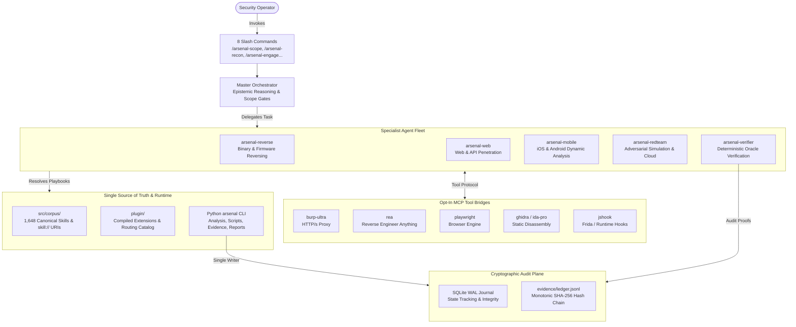

<div align="center">

# Arsenal

**Plugin-First Offensive Security & Reverse Engineering Harness for Oh My Pi (OMP)**

[](package.json)
[](LICENSE)
[](pyproject.toml)
[](https://www.typescriptlang.org)
[](docs/install-omp-plugin.md)
[](src/corpus)
[](#cli-cheat-sheet)

[ English ] &bull; [ Tiếng Việt ](README.vi.md)

</div>

---

## Overview

**Arsenal** (`@bitbytelabio/arsenal`) is an enterprise-grade offensive security engagement harness and authoritative skill corpus built for Oh My Pi (OMP). Designed for adversarial red teaming, targeted penetration testing, binary reverse engineering, and continuous dynamic vulnerability assessment, Arsenal bridges high-velocity autonomous agent coordination with deterministic verification and cryptographic evidence handling.

### Key Highlights

- **Single Source of Truth (SSOT)**: 1,648 canonical security playbooks with bundled references, templates, and source-backed helpers. Resource identifiers use `skill://<skill-id>/<path>`; bounded asset reads report when content is truncated.
- **5 Specialist Agents**: Autonomous domain specialists (`arsenal-reverse`, `arsenal-web`, `arsenal-mobile`, `arsenal-redteam`, `arsenal-verifier`) operating under structured epistemic rules (`E-*` empirical facts vs. `P-*` predictive deductions vs. `unk-*` unknowns).
- **Cryptographic Evidence Ledger**: Monotonic SHA-256 hash-chained event streams recorded to `evidence/ledger.jsonl` backed by WAL-mode SQLite state tracking for tamper-evident provenance.
- **Python CLI, Native OMP Skills**: `arsenal` owns installation, analysis, evidence, reports, and centralized operational scripts. Native TypeScript retains OMP skill discovery, loading, routing, and host hooks. Maintained parsers and official SDKs handle APK/AXML, JSON Schema, YAML, Markdown, and MCP.
- **Zero Host Mutation & Dynamic Opt-In MCP**: 6 native tool bridges (`burp-ultra`, `rea`, `playwright`, `ghidra`, `ida-pro`, `jshook`) initialize disabled, toggled safely per-profile or per-project.

---

## Architecture

Arsenal decouples declarative security specifications from operational execution and cryptographic audit trails:



---

## Specialist Agents

Arsenal provisions five domain specialists. Each agent enforces strict Operational Security (OpSec) constraints, epistemic observation boundaries, and typed handoff schemas:

| Agent | Domain | Focus & Responsibilities | Core Tooling & Methods |
|---|---|---|---|
| `arsenal-reverse` | Binary Reverse Engineering | Disassembly, decompilation, control flow graph (CFG) analysis, firmware unpacking, protocol extraction. | `ghidra`, `ida-pro`, `rea`, `file_inspect`, `binwalk` |
| `arsenal-web` | Web & API Security | Authenticated API audits, business logic flaws, OAuth/JWT vulnerability flows, injection vectors, CSRF/SSRF. | `burp-ultra`, `playwright`, native HTTP engines |
| `arsenal-mobile` | Mobile Dynamic Analysis | Android & iOS assessment, runtime instrumentation, inter-process communication (IPC), automated storage audits. | `arsenal apk inspect`, `jshook`, TLS bypass hooks, Frida |
| `arsenal-redteam` | Adversarial Simulation | Cloud infrastructure escalation, container escapes, credential relaying, lateral movement simulation. | `arsenal exec`, cloud CLI tools |
| `arsenal-verifier` | Deterministic Verification | Independent finding validation, reproduction, and falsification. | `arsenal oracle verify`, SHA-256 validation, isolated replay |

---

## Operational Slash Commands

Execute structured engagements through standard slash commands supported inside Oh My Pi:

| Command | Lifecycle Phase | Operational Function |
|---|---|---|
| `/arsenal-scope` | Pre-Engagement | Defines and strictly enforces target domains, IP blocks, and explicit out-of-scope exclusions. |
| `/arsenal-recon` | Surface Discovery | Maps attack surface; triggers interactive confirmation gates if un-scoped assets are identified. |
| `/arsenal-engage` | Engagement Loop | Drives the 5-phase structured assessment cycle across active specialist agents. |
| `/arsenal-verify` | Proof Validation | Dispatches verification requirements directly to `arsenal-verifier` using deterministic oracles. |
| `/arsenal-finding` | Finding Ingestion | Logs structured vulnerability candidates directly linked to immutable SHA-256 evidence ledger receipts. |
| `/arsenal-review` | Quality Assurance | Audits engagement state and validates continuity across all 37 validation codes. |
| `/arsenal-report` | Deliverable Export | Compiles audit findings into Markdown, JSON, and SARIF exports at `.omp/arsenal/reports/`. |
| `/arsenal-doctor` | System Diagnostics | Inspects host dependencies, plugin health, MCP bridge states, and manifest schema integrity. |

---

## Dynamic MCP Bridges

The plugin's `.mcp.json` is the source of bridge definitions. OMP loads it from the installed plugin root; `arsenal mcp install` can materialize the same entries into profile or project-native `mcp.json` while preserving operator overrides. Explicit `enabled: false` disables a bridge; otherwise the host loader applies its normal MCP defaults.

| Bridge | Primary Use Case | Execution Engine | Configuration |
|---|---|---|---|
| `burp-ultra` | Web & API Security Traffic Inspection | Burp Suite REST / Extension Bridge | Plugin manifest |
| `rea` | Universal Reverse Engineering Engine | `bunx rea-agents@6.4.0 mcp` | Plugin manifest |
| `playwright` | Headless Web Automation & DOM Inspection | Isolated Node.js / Bun worker | Plugin manifest |
| `ghidra` | Headless & GUI Java Binary Analysis | Isolated `uv` runner + Ghidra Bridge | Plugin manifest |
| `ida-pro` | Interactive Disassembler Integration | Isolated `uv` runner + IDA RPC | Plugin manifest |
| `jshook` | Mobile & Dynamic Runtime Instrumentation | Frida Hook Manager / TypeScript Bridge | Plugin manifest |

```bash
# Materialize and manage MCP bridges at profile or project scope
arsenal mcp install --scope profile --write
arsenal mcp enable rea --scope profile --write
arsenal mcp disable burp-ultra --scope project --write
arsenal mcp list
```


---

## Installation & Quick Start

Choose your preferred deployment method. For step-by-step setup details, see the [Full Plugin Installation Guide](docs/install-omp-plugin.md).

### Method 1: OMP Marketplace (Recommended)

Register the official repository and install the plugin directly into your OMP profile:

```bash
# 1. Add marketplace repository
OMP_PROFILE=arsenal omp plugin marketplace add bitbytelabio/arsenal

# 2. Install the plugin
OMP_PROFILE=arsenal omp plugin install arsenal@arsenal

# 3. Install the independent Python CLI
uv tool install git+https://github.com/bitbytelabio/arsenal.git
arsenal --help
```

### Method 2: Local Development Link

For contributors modifying playbooks or extending runtime extensions:

```bash
git clone https://github.com/bitbytelabio/arsenal.git
cd arsenal

# Build distribution bundle and link to OMP in one step
just install-local
```

### Method 3: Python CLI from Git

The npm package distributes the OMP plugin; it no longer exports a CLI binary.

```bash
uv tool install git+https://github.com/bitbytelabio/arsenal.git
arsenal --help
arsenal doctor --json
```

Use a Git commit suffix (`.git@<commit>`) for a pinned source revision. `uv tool install` resolves package metadata; it does not automatically honor the repository lockfile. Contributors and CI use `uv sync --locked` and `uv run --locked arsenal ...`.

---

## CLI Cheat Sheet

Arsenal provides a comprehensive command-line suite for managing skills, building distributions, and verifying evidence:

```bash
# Build & verify plugin distribution
arsenal build --write --force
arsenal build --check-determinism --json

# Package plugin marketplace release
arsenal plugin pack --write

# Skill corpus validation & script audit
arsenal skills check --domains --json
arsenal skills check --language --json
arsenal skills scripts-audit --json

# Check standards-based capability coverage by domain
arsenal skills coverage --domain re --check --json
arsenal skills coverage --domain webapp --check --json
arsenal skills coverage --domain mobile --check --json
arsenal skills coverage --domain red --check --json

# Verify cryptographic evidence ledger integrity
arsenal evidence verify --repo . --json

# Python CLI tests and native OMP tests
uv run --locked pytest
bun test
```

### Corpus resources and helper execution

- Edit `src/corpus/`; `plugin/skills/` is generated. Keep useful supporting documents linked from their skill entrypoint and record source provenance in `MANIFEST.json`.
- Native OMP tools still resolve `skill://` documentation and support assets. Operational helpers are resolved through the authoritative in-package catalog (`src/arsenal/scripts/catalog_data/playbook_catalog.json`); run `arsenal scripts <canonical-id> -- <arguments>` instead of copying scripts out of skills.
- Discover helpers with `arsenal scripts list` (grouped by domain, supporting `--all` and `--domain <name>`) or `arsenal scripts --json list` for complete programmatic metadata (type, domain, execution mode, admission status, side-effects, dependencies, provenance).
- Parity release gate: run `arsenal scripts catalog/verify --json` to verify strict parity between disk files, catalog descriptors, packaged resources, and historical migration receipts.
- Tiered execution boundaries: approved pure handlers run in-process (`shared`); unreviewed/legacy helpers run in isolated child processes (`managed_subprocess`); dependency-conflicted playbooks run in locked offline virtualenvs (`locked_environment`); system binaries run via allowlisted `PATH` executables with capability probes (`external_tool`).
- Fail-closed provider contracts: side-effectful playbooks require normalized machine-readable scope (`.omp/arsenal/scope.json` or `ARSENAL_SCOPE_FILE`), trusted host authorization, verified proxy routing (Burp for web/API, mitmproxy+hooks for reversing), and active evidence sinks; if any provider is missing, contradictory, or unavailable, execution is denied before invoking child interpreters or tools.
- Use `arsenal exec -- <program> <arguments>` for raw output artifacts and ledger receipts. `arsenal scripts append-evidence` preserves case evidence immutability.
- Install only needed dependency profiles, for example `uv tool install "arsenal[network] @ git+https://github.com/bitbytelabio/arsenal.git"`. Available profiles: `scripts`, `mobile`, `wireless`, `network`, `cloud`, `intel`, `forensics`, `re`, `ad`, `ai`, `analysis`, `crypto`, `vuln`.
- LLM Guard uses a separate locked Python 3.11–3.12 environment because its crypto requirements conflict with Androguard. Its runner executes locked and offline once, never installing floating dependencies during dispatch; missing synchronization reports the exact `uv sync --locked --project ...` command.

---

## Cryptographic Evidence & OpSec Guarantees

Every claim produced by Arsenal specialists must satisfy empirical verification standards before being accepted as a confirmed finding:

1. **Immutable Hash Chain**: Every command output, payload response, and packet capture is appended to `evidence/ledger.jsonl` with continuous monotonic SHA-256 linkages ($H_n = \text{SHA-256}(H_{n-1} \parallel \text{Entry}_n)$).
2. **Epistemic Classification**:
   - `E-*` (**Empirical**): Observed outputs, raw network exchanges, confirmed crash dumps.
   - `P-*` (**Predictive**): Analytical inferences, hypothesized privilege escalation paths.
   - `unk-*` (**Unknown**): Unobserved variables and incomplete telemetry.
3. **Targeted Interception Policy**:
   - Web & API traffic routes through Burp Suite; binary/application protocol reversing routes through mitmproxy with runtime hooks.
   - In-scope mobile assessment authorizes targeted TLS certificate pinning bypasses across all tiers, logging binary hashes, OS versions, and hook points without repetitive approval prompts.

---

## License

This project is licensed under the [MIT License](LICENSE).
