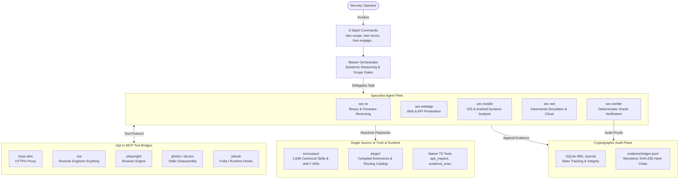

<div align="center">

# Arsenal

**Plugin-First Offensive Security & Reverse Engineering Harness for Oh My Pi (OMP)**

[](package.json)
[](LICENSE)
[](https://bun.sh)
[](https://www.typescriptlang.org)
[](docs/install-omp-plugin.md)
[](src/corpus)
[](#cli-cheat-sheet)

[ English ] &bull; [ Tiếng Việt ](README.vi.md)

</div>

---

## Overview

**Arsenal** (`@bitbytelabio/arsenal`) is an enterprise-grade offensive security engagement harness and authoritative skill corpus built for Oh My Pi (OMP). Designed for adversarial red teaming, targeted penetration testing, binary reverse engineering, and continuous dynamic vulnerability assessment, Arsenal bridges high-velocity autonomous agent coordination with deterministic verification and cryptographic evidence handling.

### Key Highlights

- **Single Source of Truth (SSOT)**: 1,648 canonical security playbooks with bundled references, templates, and source-backed helpers. Resource identifiers use `skill://<skill-id>/<path>`; bounded asset reads report when content is truncated.
- **5 Specialist Agents**: Autonomous domain specialists (`sec-re`, `sec-webapp`, `sec-mobile`, `sec-red`, `sec-verifier`) operating under structured epistemic rules (`E-*` empirical facts vs. `P-*` predictive deductions vs. `unk-*` unknowns).
- **Cryptographic Evidence Ledger**: Monotonic SHA-256 hash-chained event streams recorded to `evidence/ledger.jsonl` backed by WAL-mode SQLite state tracking for tamper-evident provenance.
- **Native Bun & TypeScript Tooling**: Core tools such as `apk_inspect` run natively. Playbook-specific helpers retain their actual Python, Bash, or PowerShell interpreter and require the dependencies documented by that playbook; execution remains subject to scope and evidence controls.
- **Zero Host Mutation & Dynamic Opt-In MCP**: 6 native tool bridges (`burp-ultra`, `rea`, `playwright`, `ghidra`, `ida-pro`, `jshook`) initialize disabled, toggled safely per-profile or per-project.

---

## Architecture

Arsenal decouples declarative security specifications from operational execution and cryptographic audit trails:



---

## Specialist Agents

Arsenal provisions five domain specialists. Each agent enforces strict Operational Security (OpSec) constraints, epistemic observation boundaries, and typed handoff schemas:

| Agent | Domain | Focus & Responsibilities | Core Tooling & Methods |
|---|---|---|---|
| `sec-re` | Binary Reverse Engineering | Disassembly, decompilation, control flow graph (CFG) analysis, firmware unpacking, protocol extraction. | `ghidra`, `ida-pro`, `rea`, `file_inspect`, `binwalk` |
| `sec-webapp` | Web & API Security | Authenticated API audits, business logic flaws, OAuth/JWT vulnerability flows, injection vectors, CSRF/SSRF. | `burp-ultra`, `playwright`, native HTTP engines |
| `sec-mobile` | Mobile Dynamic Analysis | Android & iOS assessment, runtime instrumentation, inter-process communication (IPC), automated storage audits. | `apk_inspect`, `jshook`, TLS bypass hooks, Frida |
| `sec-red` | Adversarial Simulation | Cloud infrastructure escalation, container escapes, credential relaying, lateral movement simulation. | Monitored `evidence_exec`, cloud CLI abstractions |
| `sec-verifier` | Deterministic Verification | Independent finding validation, empirical reproduction scripts, elimination of hallucinations and false positives. | `verify_oracle`, SHA-256 hash validation, isolated repro |

---

## Operational Slash Commands

Execute structured engagements through standard slash commands supported inside Oh My Pi:

| Command | Lifecycle Phase | Operational Function |
|---|---|---|
| `/sec-scope` | Pre-Engagement | Defines and strictly enforces target domains, IP blocks, and explicit out-of-scope exclusions. |
| `/sec-recon` | Surface Discovery | Maps attack surface; triggers interactive confirmation gates if un-scoped assets are identified. |
| `/sec-engage` | Engagement Loop | Drives the 5-phase structured assessment cycle across active specialist agents. |
| `/sec-verify` | Proof Validation | Dispatches verification requirements directly to `sec-verifier` using deterministic oracles. |
| `/sec-finding` | Finding Ingestion | Logs structured vulnerability candidates directly linked to immutable SHA-256 evidence ledger receipts. |
| `/sec-review` | Quality Assurance | Audits engagement state and validates continuity across all 37 validation codes. |
| `/sec-report` | Deliverable Export | Compiles audit findings into Markdown, JSON, and SARIF exports at `.omp/arsenal/reports/`. |
| `/sec-doctor` | System Diagnostics | Inspects host dependencies, plugin health, MCP bridge states, and manifest schema integrity. |

---

## Dynamic MCP Bridges

All external tool bridges use strict opt-in controls (`enabled: false` by default). Bridges can be toggled without editing raw JSON files:

| Bridge | Primary Use Case | Execution Engine | Default Status |
|---|---|---|---|
| `burp-ultra` | Web & API Security Traffic Inspection | Burp Suite REST / Extension Bridge | Disabled (`opt-in`) |
| `rea` | Universal Reverse Engineering Engine | `bunx rea-agents@6.4.0 mcp` | Disabled (`opt-in`) |
| `playwright` | Headless Web Automation & DOM Inspection | Isolated Node.js / Bun worker | Disabled (`opt-in`) |
| `ghidra` | Headless & GUI Java Binary Analysis | Isolated `uv` runner + Ghidra Bridge | Disabled (`opt-in`) |
| `ida-pro` | Interactive Disassembler Integration | Isolated `uv` runner + IDA RPC | Disabled (`opt-in`) |
| `jshook` | Mobile & Dynamic Runtime Instrumentation | Frida Hook Manager / TypeScript Bridge | Disabled (`opt-in`) |

```bash
# Manage MCP bridges at the profile or project level
bun run bin/arsenal.ts mcp enable rea --scope profile
bun run bin/arsenal.ts mcp disable burp-ultra --scope project
bun run bin/arsenal.ts mcp status
```

---

## Installation & Quick Start

Choose your preferred deployment method. For step-by-step setup details, see the [Full Plugin Installation Guide](docs/install-omp-plugin.md).

### Method 1: OMP Marketplace (Recommended)

Register the official repository and install the plugin directly into your OMP profile:

```bash
# 1. Add marketplace repository
OMP_PROFILE=arsenal omp plugin marketplace add bitbytelabio/arsenal

# 2. Install the plugin
OMP_PROFILE=arsenal omp plugin install arsenal@arsenal

# 3. Verify installation health
bunx @bitbytelabio/arsenal doctor
```

### Method 2: Local Development Link

For contributors modifying playbooks or extending runtime extensions:

```bash
git clone https://github.com/bitbytelabio/arsenal.git
cd arsenal

# Build distribution bundle and link to OMP in one step
just install-local
```

### Method 3: Direct CLI via GitHub Packages / bunx

Configure the `@bitbytelabio` scope to resolve from GitHub Packages (`~/.npmrc` or `bunfig.toml`), then run Arsenal commands directly:

```bash
# Configure GitHub Packages registry for @bitbytelabio scope (if not already set)
npm config set @bitbytelabio:registry https://npm.pkg.github.com

# Run diagnostics or check CLI options
bunx @bitbytelabio/arsenal --help
bunx @bitbytelabio/arsenal doctor --json
```

---

## CLI Cheat Sheet

Arsenal provides a comprehensive command-line suite for managing skills, building distributions, and verifying evidence:

```bash
# Build & verify plugin distribution
bun run bin/arsenal.ts build --write --force
bun run bin/arsenal.ts build --check-determinism --json

# Package plugin marketplace release
bun run bin/arsenal.ts plugin pack --write

# Skill corpus validation & script audit
bun run bin/arsenal.ts skills check --domains --json
bun run bin/arsenal.ts skills check --language --json
bun run bin/arsenal.ts skills scripts-audit --json

# Check standards-based capability coverage by domain
bun run bin/arsenal.ts skills coverage --domain re --check --json
bun run bin/arsenal.ts skills coverage --domain webapp --check --json
bun run bin/arsenal.ts skills coverage --domain mobile --check --json
bun run bin/arsenal.ts skills coverage --domain red --check --json

# Verify cryptographic evidence ledger integrity
bun run bin/arsenal.ts evidence verify --ledger evidence/ledger.jsonl --json

# Run test suite
bun test
```

### Corpus resources and helper execution

- Edit `src/corpus/`; `plugin/skills/` is generated. Keep useful supporting documents linked from their skill entrypoint and record source provenance in `MANIFEST.json`.
- `<SKILL_ROOT>` references are canonical `skill://<skill-id>/<path>` resources, not host filesystem placeholders. Resolve a resource before running it; shell interpreters do not execute `skill://` URIs. Copy the **complete** helper and its sibling dependencies to a local directory; a truncated asset preview is not an executable script.
- Match the documented interpreter and arguments to the shipped helper. The Evidence append helper is `skill://webapp-pentest-tools/support/templates/append-evidence.ps1`, requires PowerShell (`pwsh`), and rejects duplicate records, invalid severity/status, and artifact paths outside the case.


---

## Cryptographic Evidence & OpSec Guarantees

Every claim produced by Arsenal specialists must satisfy empirical verification standards before being accepted as a confirmed finding:

1. **Immutable Hash Chain**: Every command output, payload response, and packet capture is appended to `evidence/ledger.jsonl` with continuous monotonic SHA-256 linkages ($H_n = \text{SHA-256}(H_{n-1} \parallel \text{Entry}_n)$).
2. **Epistemic Classification**:
   - `E-*` (**Empirical**): Observed outputs, raw network exchanges, confirmed crash dumps.
   - `P-*` (**Predictive**): Analytical inferences, hypothesized privilege escalation paths.
   - `unk-*` (**Unknown**): Unobserved variables and incomplete telemetry.
3. **Targeted Interception Policy**:
   - Web & API traffic routes through Burp Suite; binary/application protocol reversing routes through mitmproxy with runtime hooks.
   - In-scope mobile assessment authorizes targeted TLS certificate pinning bypasses across all tiers, logging binary hashes, OS versions, and hook points without repetitive approval prompts.

---

## License

This project is licensed under the [MIT License](LICENSE).
