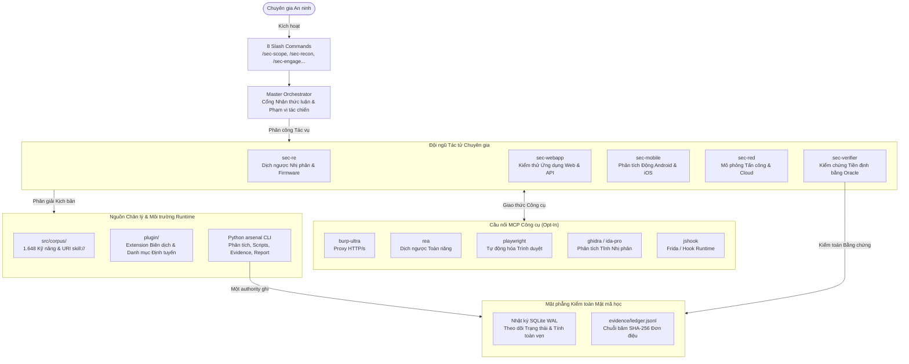

<div align="center">

# Arsenal

**Bộ khung khai thác bảo mật & dịch ngược mã nguồn (Plugin-First Harness) cho Oh My Pi (OMP)**

[](package.json)
[](LICENSE)
[](pyproject.toml)
[](https://www.typescriptlang.org)
[](docs/install-omp-plugin.vi.md)
[](src/corpus)
[](#danh-mục-lệnh-cli-cheat-sheet)

[ English ](README.md) &bull; [ Tiếng Việt ]

</div>

---

## Tổng quan

**Arsenal** (`@bitbytelabio/arsenal`) là bộ công cụ kiểm thử bảo mật chuyên nghiệp (security engagement harness) và kho lưu trữ năng lực chuẩn tắc (authoritative skill corpus) được thiết kế chuyên biệt cho Oh My Pi (OMP). Được tối ưu cho hoạt động diễn tập tấn công (red teaming), thâm nhập mục tiêu (penetration testing), dịch ngược nhị phân (binary reverse engineering), và đánh giá lỗ hổng động (dynamic vulnerability assessment), Arsenal kết hợp khả năng điều phối tác tử tự hành tốc độ cao với cơ chế kiểm chứng tiền định và quản lý bằng chứng bằng mật mã học.

### Điểm nổi bật cốt lõi

- **Mô hình Nguồn chân lý duy nhất (SSOT)**: 1.648 playbook chuẩn hóa kèm tài liệu tham khảo, template và helper có nguồn gốc xác định. Resource dùng định danh `skill://<skill-id>/<path>`; công cụ đọc asset có giới hạn kích thước và báo rõ khi nội dung bị cắt.
- **Đội ngũ 5 Tác tử Chuyên gia (Specialists)**: Các chuyên gia độc lập theo miền (`sec-re`, `sec-webapp`, `sec-mobile`, `sec-red`, `sec-verifier`) hoạt động dưới các quy tắc nhận thức luận chặt chẽ (`E-*` dữ kiện thực nghiệm vs. `P-*` suy luận dự đoán vs. `unk-*` ẩn số chưa xác định).
- **Sổ cái bằng chứng Mật mã học (Cryptographic Evidence Ledger)**: Chuỗi sự kiện gắn băm SHA-256 đơn điệu chỉ-ghi-nối (append-only) tại `evidence/ledger.jsonl`, được hỗ trợ bởi cơ chế theo dõi trạng thái SQLite chế độ WAL chống giả mạo.
- **Python CLI, skills native OMP**: `arsenal` xử lý cài đặt, phân tích, evidence, report và script tập trung. TypeScript chỉ giữ discovery/load/routing của skills cùng hooks trong OMP. APK/AXML, JSON Schema, YAML, Markdown và MCP dùng parser/SDK được duy trì.
- **Cơ chế MCP Opt-In động & An toàn tuyệt đối**: 6 cầu nối công cụ chuẩn (`burp-ultra`, `rea`, `playwright`, `ghidra`, `ida-pro`, `jshook`) mặc định ở trạng thái vô hiệu hóa, bật/tắt linh hoạt theo phạm vi profile hoặc dự án.

---

## Kiến trúc hệ thống

Arsenal phân tách rành mạch giữa tài liệu đặc tả bảo mật, luồng điều phối tác chiến, và nhật ký kiểm toán mật mã học:



---

## Ma trận Tác tử Chuyên gia

Arsenal cung cấp năm tác tử chuyên gia theo miền chuyên sâu. Mỗi tác tử tuân thủ nghiêm ngặt các rào chắn An ninh Tác chiến (OpSec), ranh giới quan sát nhận thức luận, và schema bàn giao có định kiểu:

| Tác tử | Miền chuyên môn | Trọng tâm & Trách nhiệm | Công cụ & Phương pháp cốt lõi |
|---|---|---|---|
| `sec-re` | Dịch ngược Nhị phân | Phân tích disassembled/decompiled, biểu đồ luồng điều khiển (CFG), giải nén firmware, trích xuất giao thức. | `ghidra`, `ida-pro`, `rea`, `file_inspect`, `binwalk` |
| `sec-webapp` | Bảo mật Web & API | Kiểm toán API có xác thực, lỗi logic nghiệp vụ, lỗ hổng luồng OAuth/JWT, các vector tiêm mã, CSRF/SSRF. | `burp-ultra`, `playwright`, HTTP engine native |
| `sec-mobile` | Phân tích Động Mobile | Đánh giá Android & iOS, can thiệp runtime, phân tích IPC và lưu trữ. | `arsenal apk inspect`, `jshook`, TLS bypass hooks, Frida |
| `sec-red` | Mô phỏng Đối kháng | Kiểm thử hạ tầng, cloud, container và mạng được cấp phép. | `arsenal exec`, CLI cloud |
| `sec-verifier` | Kiểm chứng độc lập | Tái hiện, xác nhận và bác bỏ finding bằng evidence. | `arsenal oracle verify`, đối soát SHA-256, replay cô lập |

---

## Danh mục Slash Commands Tác chiến

Điều phối các chiến dịch đánh giá an ninh đa giai đoạn thông qua hệ thống slash commands chuẩn hóa trong Oh My Pi:

| Lệnh | Giai đoạn Vòng đời | Chức năng Vận hành |
|---|---|---|
| `/sec-scope` | Chuẩn bị Tác chiến | Định nghĩa và thực thi nghiêm ngặt danh sách tên miền mục tiêu, dải IP, và các tài sản loại trừ ngoài phạm vi. |
| `/sec-recon` | Khám phá Bề mặt | Lập bản đồ bề mặt tấn công; kích hoạt yêu cầu xác nhận tương tác nếu phát hiện tài sản chưa được cấp phép. |
| `/sec-engage` | Vòng lặp Khai thác | Điều phối quy trình đánh giá có cấu trúc 5 giai đoạn xuyên suốt các tác tử chuyên gia đang kích hoạt. |
| `/sec-verify` | Xác thực Bằng chứng | Chuyển giao trực tiếp yêu cầu kiểm chứng tới `sec-verifier` bằng các oracle tiền định. |
| `/sec-finding` | Ghi nhận Phát hiện | Lưu trữ các lỗ hổng tiềm năng có cấu trúc, liên kết trực tiếp với biên lai sổ cái bằng chứng băm SHA-256. |
| `/sec-review` | Đảm bảo Chất lượng | Kiểm toán trạng thái chiến dịch và xác nhận tính liên tục của bằng chứng trên toàn bộ 37 mã xác thực. |
| `/sec-report` | Xuất Báo cáo | Biên dịch kết quả kiểm toán thành định dạng Markdown, JSON, và SARIF tại thư mục `.omp/arsenal/reports/`. |
| `/sec-doctor` | Chẩn đoán Hệ thống | Kiểm tra các phụ thuộc máy host, độ lành mạnh của plugin, trạng thái MCP bridges, và tính toàn vẹn manifest. |

---

## Cầu nối MCP Động

Toàn bộ các cầu nối công cụ ngoài vận hành theo cơ chế chọn tham gia (opt-in) nghiêm ngặt (`enabled: false` theo mặc định). Bạn có thể bật/tắt cầu nối mà không cần chỉnh sửa thủ công các tệp JSON:

| Cầu nối | Mục đích Sử dụng Chính | Động cơ Thực thi | Trạng thái Mặc định |
|---|---|---|---|
| `burp-ultra` | Giám sát & Phân tích Lưu lượng Web & API | Cầu nối REST / Extension của Burp Suite | Vô hiệu hóa (`opt-in`) |
| `rea` | Động cơ Dịch ngược Toàn năng | `bunx rea-agents@6.4.0 mcp` | Vô hiệu hóa (`opt-in`) |
| `playwright` | Tự động hóa Trình duyệt & Kiểm tra DOM | Worker Node.js / Bun cô lập | Vô hiệu hóa (`opt-in`) |
| `ghidra` | Phân tích Nhị phân Java (Headless & GUI) | Môi trường `uv` cô lập + Ghidra Bridge | Vô hiệu hóa (`opt-in`) |
| `ida-pro` | Tích hợp Trình Dịch ngược Tương tác IDA | Môi trường `uv` cô lập + IDA RPC | Vô hiệu hóa (`opt-in`) |
| `jshook` | Can thiệp Runtime Động Ứng dụng Di động | Trình quản lý Hook Frida / Cầu nối TS | Vô hiệu hóa (`opt-in`) |

```bash
# Quản lý cầu nối MCP ở cấp độ profile hoặc project
arsenal mcp enable rea --scope profile --write
arsenal mcp disable burp-ultra --scope project --write
arsenal mcp list
```

---

## Hướng dẫn Cài đặt & Bắt đầu Nhanh

Chọn phương thức triển khai phù hợp với bạn. Chi tiết từng bước vui lòng xem tại [Tài liệu Cài đặt Plugin Toàn diện](docs/install-omp-plugin.vi.md).

### Phương thức 1: OMP Marketplace (Khuyến nghị)

Đăng ký kho lưu trữ chính thức và cài đặt plugin trực tiếp vào profile OMP của bạn:

```bash
# 1. Thêm kho lưu trữ marketplace
OMP_PROFILE=arsenal omp plugin marketplace add bitbytelabio/arsenal

# 2. Cài đặt plugin
OMP_PROFILE=arsenal omp plugin install arsenal@arsenal

# 3. Cài Python CLI riêng
uv tool install git+https://github.com/bitbytelabio/arsenal.git
arsenal --help
```

### Phương thức 2: Liên kết Phát triển Cục bộ (Local Link)

Dành cho các nhà phát triển tinh chỉnh kịch bản hoặc mở rộng runtime extensions:

```bash
git clone https://github.com/bitbytelabio/arsenal.git
cd arsenal

# Biên dịch gói phân phối và liên kết tới OMP chỉ trong một lệnh
just install-local
```

### Phương thức 3: Python CLI từ Git

Package npm phân phối plugin OMP, không còn xuất CLI binary.

```bash
uv tool install git+https://github.com/bitbytelabio/arsenal.git
arsenal --help
arsenal doctor --json
```

Thêm `.git@<commit>` để ghim revision. `uv tool install` resolve theo metadata package, không tự dùng lockfile của repo. Môi trường phát triển và CI dùng `uv sync --locked`, `uv run --locked arsenal ...`.

---

## Danh mục Lệnh CLI (Cheat Sheet)

Arsenal cung cấp bộ công cụ dòng lệnh toàn diện để quản trị kỹ năng, đóng gói phân phối và xác thực bằng chứng:

```bash
# Biên dịch & kiểm chứng gói phân phối plugin
arsenal build --write --force
arsenal build --check-determinism --json

# Đóng gói bản phát hành marketplace
arsenal plugin pack --write

# Kiểm toán kho kỹ năng & rà soát mã thực thi
arsenal skills check --domains --json
arsenal skills check --language --json
arsenal skills scripts-audit --json

# Kiểm tra độ phủ năng lực theo chuẩn theo từng miền
arsenal skills coverage --domain re --check --json
arsenal skills coverage --domain webapp --check --json
arsenal skills coverage --domain mobile --check --json
arsenal skills coverage --domain red --check --json

# Xác thực tính toàn vẹn của sổ cái bằng chứng mật mã học
arsenal evidence verify --repo . --json

# Kiểm thử Python CLI và native OMP
uv run --locked pytest
bun test
```

### Resource của corpus và cách chạy helper

- Chỉnh sửa tại `src/corpus/`; `plugin/skills/` là đầu ra được sinh. Liên kết tài liệu hỗ trợ hữu ích từ trang chính của skill và ghi nguồn gốc trong `MANIFEST.json`.
- Native OMP tiếp tục resolve tài liệu/asset `skill://`. Mã thực thi nằm trong `src/arsenal/scripts/`; chạy `arsenal scripts <canonical-id> -- <tham-số>` thay vì sao chép script từ skill.
- Dùng `arsenal exec -- <chương-trình> <tham-số>` để lưu raw output và receipt. `arsenal scripts append-evidence` giữ tính bất biến của evidence trong case.
- Chỉ cài nhóm dependency cần dùng, ví dụ `uv tool install "arsenal-security[network] @ git+https://github.com/bitbytelabio/arsenal.git"`. Các nhóm: `scripts`, `mobile`, `wireless`, `network`, `cloud`, `intel`, `forensics`, `re`, `ad`, `ai`, `analysis`, `crypto`, `vuln`.
- LLM Guard dùng môi trường khóa riêng Python 3.11–3.12 do xung đột crypto với Androguard. Runner báo đường dẫn lệnh `uv sync --locked --project ...` để chuẩn bị; lúc chạy không tự tải dependency trôi nổi.


---

## Sổ cái Bằng chứng & Cam kết OpSec

Mọi kết luận do các chuyên gia của Arsenal đưa ra đều phải thỏa mãn tiêu chuẩn kiểm chứng thực nghiệm trước khi được ghi nhận là lỗ hổng hợp lệ:

1. **Chuỗi băm Bất biến (Immutable Hash Chain)**: Toàn bộ đầu ra câu lệnh, phản hồi payload, và dữ liệu bắt gói tin đều được ghi nối vào `evidence/ledger.jsonl` với liên kết băm SHA-256 đơn điệu liên tục ($H_n = \text{SHA-256}(H_{n-1} \parallel \text{Entry}_n)$).
2. **Phân loại Nhận thức luận (Epistemic Classification)**:
   - `E-*` (**Thực nghiệm - Empirical**): Dữ liệu quan sát trực tiếp, trao đổi mạng thô, crash dump được xác nhận.
   - `P-*` (**Dự đoán - Predictive**): Suy luận phân tích, giả thuyết đường dẫn leo thang đặc quyền.
   - `unk-*` (**Ẩn số - Unknown**): Các biến số chưa được quan sát và dữ liệu đo đạc chưa đầy đủ.
3. **Chính sách Bắt chặn Lưu lượng Có định hướng**:
   - Lưu lượng Web & API được định tuyến qua Burp Suite; giao thức dịch ngược ứng dụng nhị phân được điều hướng qua mitmproxy kèm runtime hooks.
   - Khi đánh giá ứng dụng di động trong phạm vi, chuyên gia được ủy quyền triển khai vượt cơ chế khóa chứng chỉ TLS (SSL pinning bypass) trên mọi tầng mà không cần xác nhận lặp lại, đồng thời ghi lại đầy đủ hash nhị phân, phiên bản hệ điều hành và vị trí đặt hook.

---

## Giấy phép

Dự án này được phân phối theo các điều khoản của [Giấy phép MIT](LICENSE).
